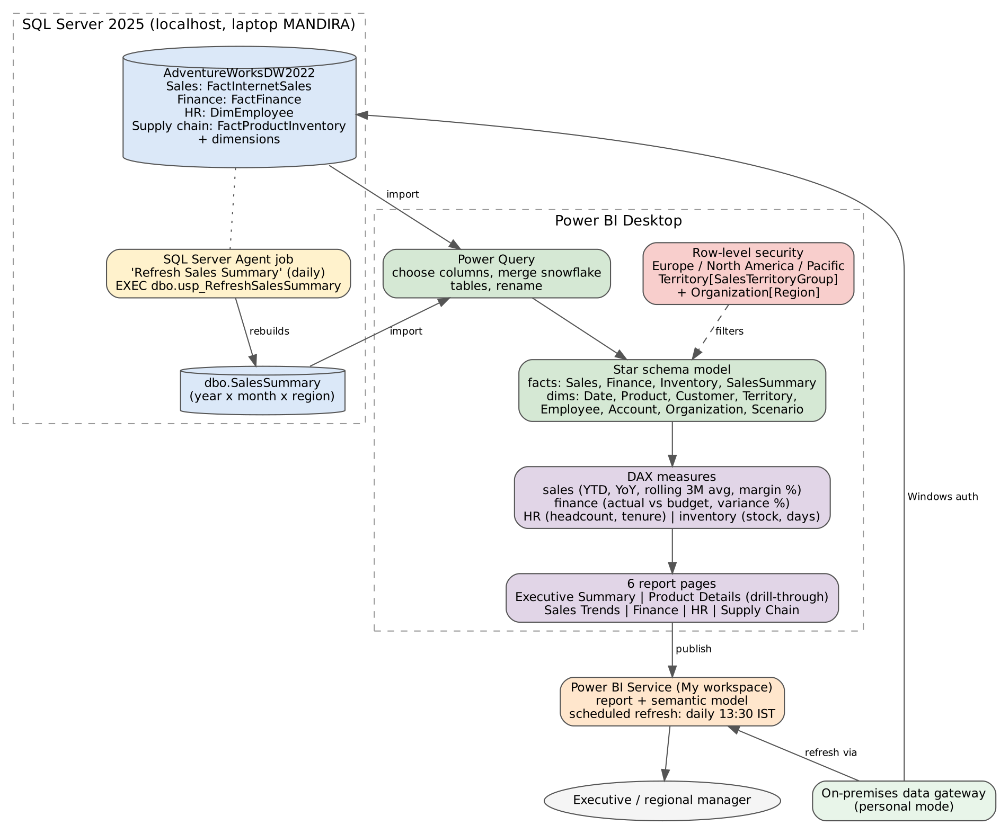
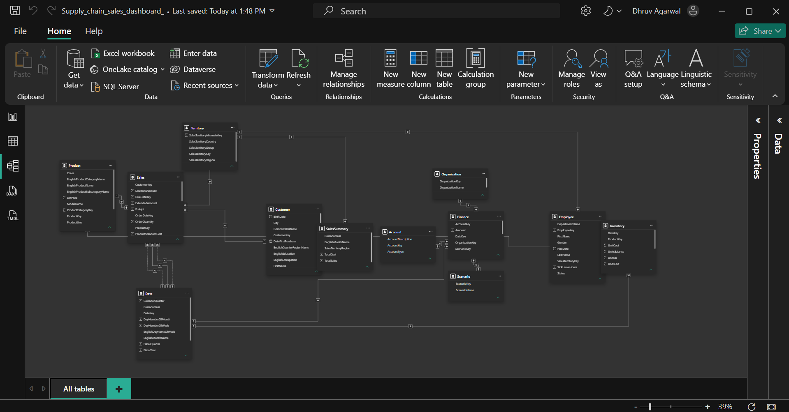

# Enterprise Business Intelligence Suite (Power BI + SQL Server)

One Power BI report that brings together **sales, finance, HR and supply chain** data from the AdventureWorks data warehouse, with **row-level security** so each regional manager sees only their own region. Data is refreshed by a scheduled SQL Server Agent job and a daily scheduled refresh in Power BI Service.

**Project:** DA-01, Data Analytics track | **Author:** Mandira Biswas | **Submission date:** 20 Nov 2026

---

## 1. Tech stack

| Layer | Tool |
|---|---|
| Database | SQL Server 2025 (Evaluation) + SSMS 22 |
| Data source | AdventureWorksDW2022 |
| Data movement | SQL Server Agent job + stored procedure (the brief allows scheduled SQL jobs when Azure is unavailable; Azure Data Factory was not used) |
| ETL / cleaning | Power Query |
| Modelling | Power BI star schema + DAX |
| Security | Power BI row-level security (3 regional roles) |
| Delivery and refresh | Power BI Service (My workspace) + on-premises data gateway (personal mode), daily scheduled refresh |

## 2. Architecture



1. **SQL Server** holds AdventureWorksDW2022. A SQL Server Agent job runs `dbo.usp_RefreshSalesSummary` every day and rebuilds `dbo.SalesSummary` (sales by year, month and region).
2. **Power BI Desktop** imports the warehouse tables and `SalesSummary`, cleans them in Power Query and models them as a star schema.
3. The report is **published** to Power BI Service. The **personal gateway** on the SQL Server laptop lets the Service refresh the data every day at 13:30 IST, after the SQL job has run.

## 3. Data model



Every fact table connects to its dimensions with **one-to-many, single-direction** relationships. Snowflaked tables were merged in Power Query so each fact has a clean star around it:
- `DimProductSubcategory` and `DimProductCategory` were merged into **Product**
- `DimGeography` was merged into **Customer**

| Area | Fact table (source) | Dimensions |
|---|---|---|
| Sales | **Sales** (FactInternetSales) | Date, Product, Customer, Territory |
| Sales (from SQL job) | **SalesSummary** (dbo.SalesSummary) | Territory (on SalesTerritoryRegion) |
| Finance | **Finance** (FactFinance) | Date, Account, Organization, Scenario |
| HR | **Employee** (DimEmployee) | Territory (on SalesTerritoryKey) |
| Supply chain | **Inventory** (FactProductInventory) | Date, Product |

`Date` is marked as the date table. On `Sales`, the order date relationship is active and the other date keys are inactive, so time intelligence uses order date. Full column descriptions are in [`docs/DATA_DICTIONARY.md`](docs/DATA_DICTIONARY.md).

## 4. DAX measures

**Sales**
```DAX
Total Sales      = SUM(Sales[SalesAmount])
Total Cost       = SUM(Sales[TotalProductCost])
Profit           = [Total Sales] - [Total Cost]
Margin %         = DIVIDE([Profit], [Total Sales])
Sales YTD        = IF(NOT ISBLANK([Total Sales]), TOTALYTD([Total Sales], 'Date'[FullDateAlternateKey]))
Sales Prior Year = CALCULATE([Total Sales], SAMEPERIODLASTYEAR('Date'[FullDateAlternateKey]))
YoY Growth %     = IF(NOT ISBLANK([Total Sales]), DIVIDE([Total Sales] - [Sales Prior Year], [Sales Prior Year]))
Sales Rolling 3M = IF(NOT ISBLANK([Total Sales]),
                     CALCULATE([Total Sales], DATESINPERIOD('Date'[FullDateAlternateKey], MAX('Date'[FullDateAlternateKey]), -3, MONTH)))
Sales Rolling 3M Avg = DIVIDE([Sales Rolling 3M], 3)
```

**Finance** (actual vs budget)
```DAX
Actual Revenue  = CALCULATE(SUM(Finance[Amount]), Scenario[ScenarioName] = "Actual", Account[AccountType] = "Revenue")
Budget Revenue  = CALCULATE(SUM(Finance[Amount]), Scenario[ScenarioName] = "Budget", Account[AccountType] = "Revenue")
Actual Expenses = CALCULATE(SUM(Finance[Amount]), Scenario[ScenarioName] = "Actual", Account[AccountType] = "Expenditures")
Budget Expenses = CALCULATE(SUM(Finance[Amount]), Scenario[ScenarioName] = "Budget", Account[AccountType] = "Expenditures")

-- Budgets only exist for some periods and divisions, so variance compares actuals only where a budget exists
Actual Revenue (Budgeted) = SUMX(SUMMARIZE(Finance, 'Date'[DateKey], Organization[OrganizationKey]),
                                 IF(NOT ISBLANK([Budget Revenue]), [Actual Revenue]))
Revenue Variance   = [Actual Revenue (Budgeted)] - [Budget Revenue]
Revenue Variance % = DIVIDE([Revenue Variance], [Budget Revenue])
```

**HR**
```DAX
Headcount            = CALCULATE(COUNTROWS(Employee), Employee[Status] = "Current")
Avg Tenure (Years)   = AVERAGEX(FILTER(Employee, Employee[Status] = "Current"),
                         DATEDIFF(Employee[HireDate], DATE(2014, 1, 31), DAY)) / 365.25   -- measured to the end of the data
Avg Vacation Hours   = AVERAGE(Employee[VacationHours])
Avg Sick Leave Hours = AVERAGE(Employee[SickLeaveHours])
```

**Supply chain** (stock is a snapshot, so it is taken on the latest day in the current filter, not summed over days)
```DAX
Stock on Hand       = VAR LastDay = MAX(Inventory[DateKey])
                      RETURN CALCULATE(SUM(Inventory[UnitsBalance]), Inventory[DateKey] = LastDay)
Stock Value         = VAR LastDay = MAX(Inventory[DateKey])
                      RETURN CALCULATE(SUMX(Inventory, Inventory[UnitsBalance] * Inventory[UnitCost]), Inventory[DateKey] = LastDay)
Units Out           = SUM(Inventory[UnitsOut])
Avg Daily Units Out = DIVIDE([Units Out], DISTINCTCOUNT(Inventory[DateKey]))
Days of Inventory   = DIVIDE([Stock on Hand], [Avg Daily Units Out])
```

## 5. Report pages

| Page | What it shows | Screenshot |
|---|---|---|
| **Executive Summary** | Total Sales, Profit, Margin % cards; sales by month, category and territory; year slicer | [docs/executive_summary.png](docs/executive_summary.png) |
| **Product Details** (drill-through) | Product-level Sales, Profit, Margin %. Right-click a category on Executive Summary → Drill through | [docs/product_details.png](docs/product_details.png) |
| **Sales Trends** | Matrix of Total Sales, YTD, Prior Year, YoY %, Rolling 3M Avg by year and month; line chart of sales vs rolling average; table from the SQL job's `SalesSummary` | [docs/sales_trends.png](docs/sales_trends.png) |
| **Finance** | Actual vs budget revenue by year, revenue variance by division, expenses by account | [docs/finance.png](docs/finance.png) |
| **HR** | Headcount, average tenure, vacation and sick leave; headcount by department, region and gender | [docs/hr.png](docs/hr.png) |
| **Supply Chain** | Stock on hand, stock value, units out, days of inventory; units in vs out by month; stock value by category; products with the lowest days of inventory | [docs/supply_chain.png](docs/supply_chain.png) |

## 6. Row-level security

Three roles (**Modeling → Manage roles**). Each role has two rules, one per table, and both apply:

| Role | Rule on `Territory` | Rule on `Organization` |
|---|---|---|
| Europe | `[SalesTerritoryGroup] = "Europe"` | `[Region] = "Europe"` |
| North America | `[SalesTerritoryGroup] = "North America"` | `[Region] = "North America"` |
| Pacific | `[SalesTerritoryGroup] = "Pacific"` | `[Region] = "Pacific"` |

- The `Territory` rule flows to **Sales**, **SalesSummary** and **Employee**.
- `Organization[Region]` is a calculated column that maps each finance organization to a region (head office "AdventureWorks Cycle" maps to "Corporate", so regional managers do not see it):

```DAX
Region = SWITCH(TRUE(),
    Organization[OrganizationName] IN {"USA Operations", "North America Operations", "Northwest Division", "Northeast Division",
                                       "Central Division", "Southeast Division", "Southwest Division", "Canadian Division"}, "North America",
    Organization[OrganizationName] IN {"European Operations", "France", "Germany"}, "Europe",
    Organization[OrganizationName] IN {"Pacific Operations", "Australia"}, "Pacific",
    "Corporate")
```

Proof: [docs/rls_roles.png](docs/rls_roles.png), [docs/rls_europe_sales.png](docs/rls_europe_sales.png), [docs/rls_europe_finance.png](docs/rls_europe_finance.png), [docs/rls_europe_hr.png](docs/rls_europe_hr.png).

## 7. Data refresh

**SQL Server Agent job** (script: [`sql/usp_RefreshSalesSummary.sql`](sql/usp_RefreshSalesSummary.sql))
- Job `Refresh Sales Summary`, one step: `EXEC dbo.usp_RefreshSalesSummary;`
- Daily schedule ("Schedule 9 (Daily)"). Job history shows repeated successful runs **invoked by Schedule**, including 12 Nov 2026 14:30: [docs/SQL_Agent_Job.png](docs/SQL_Agent_Job.png)
- The SQL Server Agent service is set to start automatically.

**Power BI Service scheduled refresh**
- Personal gateway on the SQL Server laptop, status *online*: [docs/gateway.online.png](docs/gateway.online.png)
- Data source credentials: Windows (without impersonation), privacy level Organizational
- Daily refresh at 13:30 IST, after the SQL job: [docs/refresh_schedule.png](docs/refresh_schedule.png)
- Successful refresh on 12 Nov 2026: [docs/refresh_history.png](docs/refresh_history.png)

## 8. Setup instructions

1. Install SQL Server (Evaluation), SSMS and Power BI Desktop.
2. Restore `AdventureWorksDW2022.bak` in SSMS (**Databases → Restore Database → Device**).
3. Run [`sql/usp_RefreshSalesSummary.sql`](sql/usp_RefreshSalesSummary.sql) on `AdventureWorksDW2022`. It creates the procedure and runs it once.
4. Enable SQL Server Agent and create the job:
   ```sql
   EXEC sp_configure 'show advanced options', 1; RECONFIGURE;
   EXEC sp_configure 'Agent XPs', 1; RECONFIGURE;
   ```
   In SSMS: **SQL Server Agent → Jobs → New Job**, add a T-SQL step `EXEC dbo.usp_RefreshSalesSummary;` on `AdventureWorksDW2022`, and a daily schedule. Set the **SQL Server Agent** Windows service to **Automatic**.
5. Open `Supply_Chain_Sales_Dashboard.pbix`. If asked, change the server name in **Transform data → Data source settings** and untick **Use encrypted connection** for a local server. Click **Refresh**.
6. **Publish** to your workspace.
7. For scheduled refresh: install the **on-premises data gateway (personal mode)**, sign in with the same Power BI account, then in the semantic model's **Settings** set **Data source credentials** (Windows) and a daily **Refresh** time after the SQL job.

## 9. Testing

| # | Test | Expected | Result |
|---|---|---|---|
| 1 | Total Sales, all years and regions | Matches `SUM(FactInternetSales.SalesAmount)` | Pass: $29,358,677 |
| 2 | Margin % | Profit / Sales | Pass: 41.15% |
| 3 | Star schema merge did not change totals | Total Sales and Margin % unchanged after merging snowflake tables | Pass |
| 4 | Sales YTD | Feb 2011 YTD = Jan + Feb | Pass: $469,824 + $466,335 = $936,159 |
| 5 | Rolling 3M average | Jan 2011 = (Nov + Dec 2010 + Jan 2011) / 3 | Pass: $171,082; Mar 2011 = $473,786 |
| 6 | SQL job output matches the model | `SalesSummary` total = Total Sales | Pass: $29,358,677 |
| 7 | Drill-through | Right-click Bikes → Product Details shows only bikes | Pass: $28,318,145 (Bikes only) |
| 8 | RLS: regions add up with no gaps or overlaps | Europe + North America + Pacific = unrestricted total (Bikes) | Pass: $8,644,933 + $10,821,162 + $8,852,050 = $28,318,145 |
| 9 | RLS "Europe" view | Only UK, Germany, France on sales; only European organizations on Finance; only European sales staff on HR | Pass |
| 10 | Finance variance only compares budgeted periods | Variance % uses actuals where a budget exists | Pass: −9.6% (before the fix it showed a misleading +329%) |
| 11 | HR headcount | Current employees only | Pass: 290 |
| 12 | SQL Agent job runs on its schedule | History shows "invoked by Schedule" | Pass |
| 13 | Scheduled refresh in Power BI Service | Refresh completes through the gateway | Pass (12 Nov 2026) |

## 10. Limitations and next steps

- **Data movement:** Azure Data Factory was not used because Azure was not available; the brief allows scheduled SQL jobs instead. Next step: an ADF pipeline copying to Azure SQL would remove the need for a laptop gateway.
- **Runs on one laptop:** the SQL job and the gateway only work while the laptop is on. Runs are skipped when it is off (seen in the job history between 6 and 12 Nov).
- **Budget data is limited:** AdventureWorks budgets cover 2010–2011 and North American divisions only, so European and Pacific managers see actuals but no budget.
- **Inventory has no region:** `FactProductInventory` is company-wide, so all roles see the same Supply Chain page.
- **HR by region covers sales staff only:** other employees have no sales territory, so regional roles see only their sales team.
- **Days of Inventory at company level is high (~1,200 days)** because many components rarely ship. The product table, sorted lowest first, is the useful view.
- **Ship dates are not used for delivery KPIs:** in AdventureWorks, ship date is always a fixed number of days after the order date.
- Next steps: Customer Details drill-through page; dynamic RLS by user email; incremental refresh.

## 11. Repository contents

```
README.md                          this file
User_Guide.md                      one-page guide for report users
Supply_Chain_Sales_Dashboard.pbix  the Power BI report
sql/usp_RefreshSalesSummary.sql    stored procedure used by the SQL Agent job
docs/architecture.png              architecture diagram
docs/DATA_DICTIONARY.md            tables, columns and measures
docs/*.png                         screenshots and proof (model, pages, RLS, job, gateway, refresh)
```
